<div align="center">
  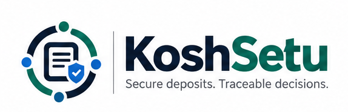

  # KoshSetu

  **Secure deposits. Traceable decisions.**

  A security-first platform for managing institutional security deposits and Fixed Deposit Receipts (FDRs) — from submission and document scrutiny to maturity tracking, renewal, controlled release and auditable decisions.

  [](https://www.sih.gov.in/sih2026PS)
  
  
  

  **[Overview](#overview) · [Features](#features) · [Architecture](#architecture) · [Getting started](#getting-started) · [Security](#security-by-design) · [API](#api-overview)**
</div>

> [!IMPORTANT]
> **Independent SIH Prototype & Repository Phase.** KoshSetu was developed around **Smart India Hackathon 2026 problem statement SIH26265**, issued by the **AICTE Regulation Bureau**: **“Streamline of security deposit/ FDR portal.”**
> - **Current Repository State:** This repository houses the complete architectural specification, design tokens, responsive screenshots, and engineering contracts. Core backend and frontend code modules (`apps/api`, `apps/web`) are maintained alongside this specification.
> - **Bank Integration Disclaimer:** It is **not** an official AICTE or bank website. Every bank-verification response in the demo is synthetic (`MOCK_BANK`) and **does not authenticate any real FDR, confirm a real lien, or authorize a financial release**.
> - **Full Specifications:** Read the [Backend Architecture & Security Specification](docs/backend-specification.md) and [Frontend Product & UI/UX Specification](docs/frontend-specification.md) directly in GitHub.

---

## Overview

Institutions and regulators often manage FDR evidence across documents, spreadsheets, correspondence and disconnected approval steps. That makes it difficult to answer basic questions reliably: Which instrument is currently valid? What has actually been checked? What matures soon? Which clearance is holding up a release? Who made the final decision, on which evidence?

**KoshSetu brings the entire lifecycle into one controlled workspace.** Institutions submit and track instruments; authorized officers inspect evidence, record discrepancies, run simulated bank-verification scenarios, review exceptions and process policy-gated release requests. Each material action is linked to its actor, timestamp, source evidence and case version.

### What makes KoshSetu different?

| Conventional workflow | KoshSetu |
| --- | --- |
| FDR details scattered across files and correspondence | Canonical, institution-scoped instrument register |
| Manual transcription and hard-to-compare PDFs | Native PDF extraction, OCR fallback and evidence-linked comparison |
| Ambiguous “verified” labels | Separate document, mock-bank and officer-review outcomes |
| Maturity deadlines tracked manually | Scheduled reminders, accountable action queues and renewal chains |
| Release files passed informally between stakeholders | Configurable clearance checklist with maker–checker authorization |
| Unexplained flags or black-box “fraud” claims | Deterministic **Integrity & Action Engine** with rule IDs and supporting evidence |
| Difficult-to-reconstruct decisions | Versioned records and append-only audit events |

### Problem statement

| Field | Detail |
| --- | --- |
| **ID** | `SIH26265` |
| **Official title** | Streamline of security deposit/ FDR portal. |
| **Organization** | All India Council for Technical Education (AICTE), Regulation Bureau |
| **Hackathon** | Smart India Hackathon 2026 |
| **Category / theme** | Software / Smart Automation |
| **Project** | **KoshSetu** |

The solution covers record creation, submission, document scrutiny, discrepancy handling, simulated bank integration, maturity and renewal monitoring, configurable release workflows, operational reporting and accountable audit histories. Actual bank connectivity is outside the SIH demonstration boundary.

---

## Product preview

These are **illustrative interface previews using synthetic records**, not evidence of a government production deployment.

<div align="center">
  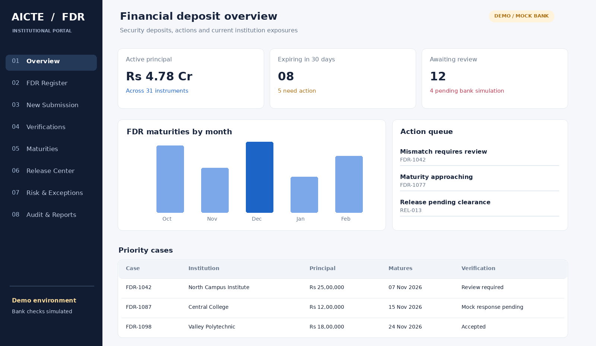
  <sub>Portfolio overview — deposit exposure, upcoming maturities and work requiring attention</sub>
</div>

<br />

<table>
  <tr>
    <td width="50%">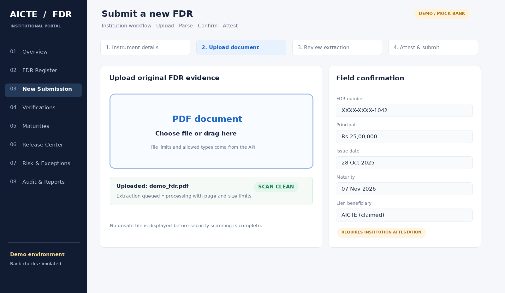<br /><sub>Secure document intake and structured field review</sub></td>
    <td width="50%">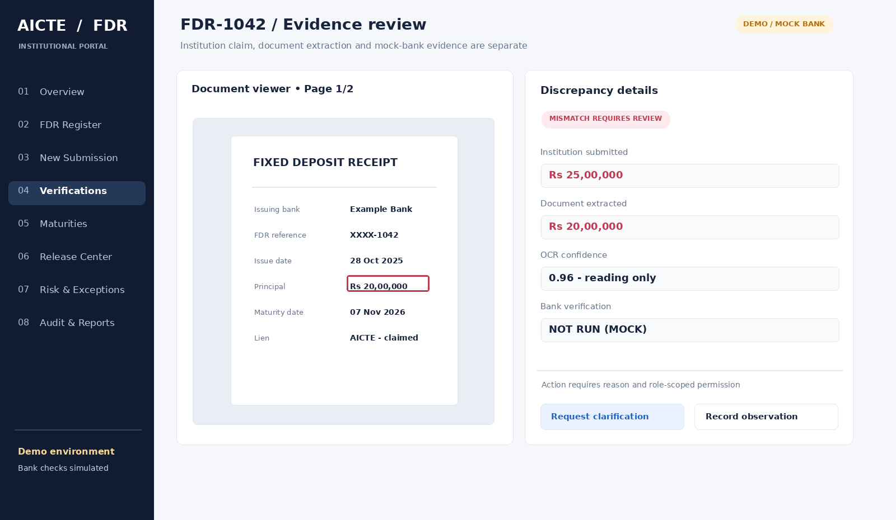<br /><sub>PDF-to-field evidence comparison</sub></td>
  </tr>
  <tr>
    <td>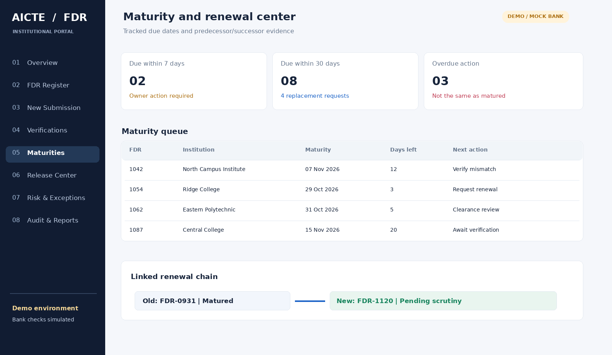<br /><sub>Maturity monitoring and replacement lineage</sub></td>
    <td>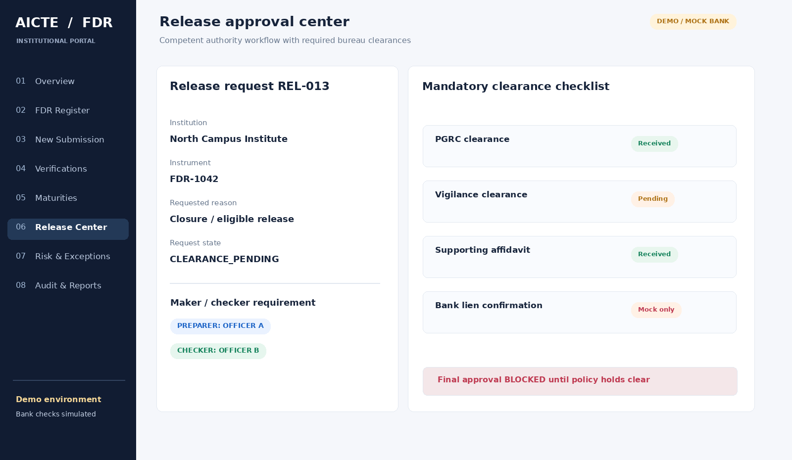<br /><sub>Release eligibility and approval prerequisites</sub></td>
  </tr>
</table>

<details>
<summary><strong>More screens — explainable findings and audit history</strong></summary>

<br />

| Integrity & Action Engine | Audit explorer |
| --- | --- |
| 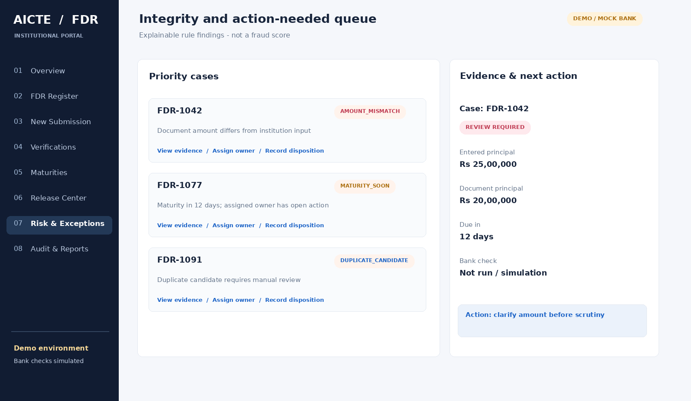 | 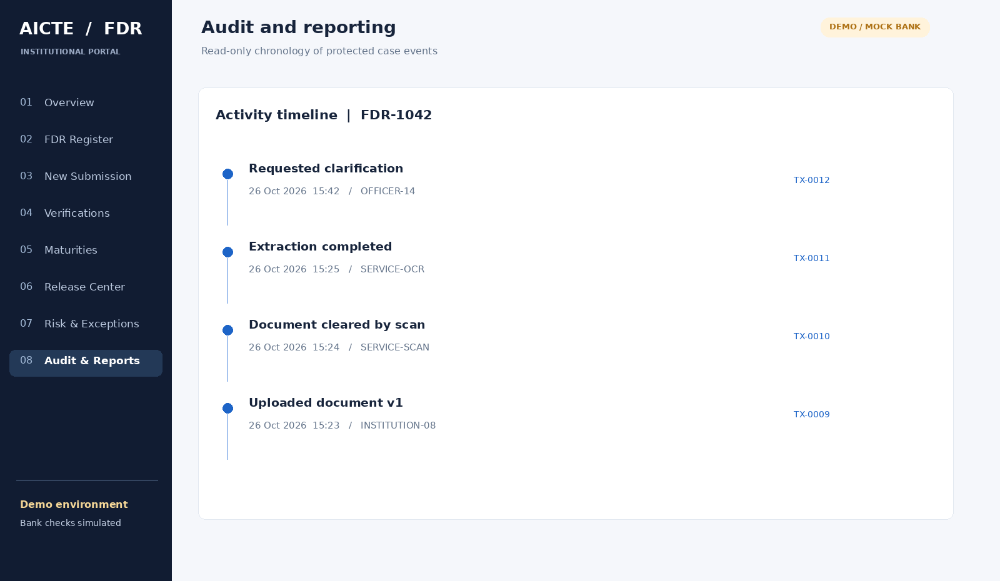 |

</details>

> **Brand note:** Some illustrative screen concepts retain the early “AICTE / FDR” working header; **KoshSetu** is the product brand. None of the images represents an official AICTE interface.

---

## Features

### 1. Institution workspace

- **Institution-scoped registry:** access limited to the authenticated institution's instruments, documents and actions.
- **Guided FDR submission:** draft → metadata → secure upload → extraction review → institution attestation.
- **Document versioning:** corrections and replacement files preserve historical evidence rather than overwriting it.
- **Renewal / replacement lineage:** predecessor and successor instruments remain linked and inspectable.
- **Release requests:** submit supporting evidence and track outstanding clearances without assuming maturity implies eligibility.
- **Notifications and activity:** status updates, clarification requests and approaching deadlines.

### 2. Authorized officer workspace

- **Portfolio dashboard:** aggregate views restricted to the officer's assigned jurisdiction and permissions.
- **Case work queue:** filter by institution, bank, date, exception type, assignment or urgency.
- **Evidence workbench:** PDF preview, source-page highlighting, entered-versus-extracted field comparison and recorded observations.
- **Scrutiny decisions:** request clarification, accept a submitted case, reject with reasons or escalate under defined policy.
- **Release & clearance center:** required evidence, bureau-specific clearances, holds and dual-control approval.
- **Reports and audit explorer:** scoped exports and searchable activity histories with correlation identifiers.

### 3. Document intelligence

KoshSetu reduces repetitive data entry while keeping the human reviewer in control:

1. Quarantine uploaded documents and validate file type, size and content.
2. Extract native PDF text using **PyMuPDF**; apply OCR to scanned pages where necessary.
3. Structure candidate fields such as FDR number, issuer bank, principal, issue date, maturity date and lien information.
4. Preserve confidence, extraction method, page references and evidence regions.
5. Compare the institution's claims with parsed values and request confirmation or correction.

**OCR is data extraction, not issuer authentication.** Missing or low-confidence fields remain unresolved until reviewed.

#### Indian Banking Document Realities & Engineering Controls
Physical FDR receipts from Indian public and private sector banks (SBI, PNB, Canara Bank, HDFC, etc.) introduce practical extraction challenges:
- **Ink Rubber Stamps over Text:** Bank branch seals and revenue stamps often overlap FDR numbers or principal amounts. KoshSetu uses OpenCV color thresholding (HSV space) and morphological filtering to segment darker printed typography from colored stamp ink before OCR.
- **Bilingual Receipts (Hindi / English):** Tesseract OCR pipeline is configured with combined language traineddata (`eng+hin`) to parse bilingual tabular fields accurately without dropping Hindi headers or labels.
- **Dot-Matrix Printing & Degradation:** Low-resolution carbon copies and dot-matrix receipts undergo adaptive Gaussian thresholding and deskew correction.
- **Confidence Threshold & Human-in-the-Loop:** Any extracted field with confidence `< 0.85` triggers a mandatory visual flag in the split-screen evidence review workbench, requiring explicit human reviewer attestation.

### 4. Explainable Integrity & Action Engine

Rather than presenting a speculative AI “fraud score,” the system generates reviewable findings from versioned rules.

| Finding | Example | Result |
| --- | --- | --- |
| Document mismatch | Entered principal differs from PDF extraction | Flag field, source page and reviewer action |
| Deadline exposure | Accepted FDR matures in 12 days | Assign actionable maturity reminder |
| Incomplete verification | External evidence unavailable / mock check pending | Preserve `UNVERIFIED` provenance |
| Lien discrepancy | Lien claim differs from available evidence | Request clarification or escalate |
| Duplicate candidate | Similar instrument reference appears elsewhere | Queue human review; do not auto-merge |
| Release hold | Required clearance missing or negative | Block final approval under configured policy |

A finding contains its **rule ID, severity, evidence, timestamp, case version, owner and recommended next step**. It does not establish fraud, misconduct or authenticity.

### 5. Simulated bank verification

The bank adapter supports deterministic scenarios for testing and demonstrating the complete workflow:

- `MATCH_AND_LIEN_CONFIRMED`
- `AMOUNT_MISMATCH`
- `REFERENCE_NOT_FOUND`
- `LIEN_NOT_CONFIRMED`
- `BANK_TIMEOUT`
- `MALFORMED_RESPONSE`
- `RATE_LIMITED`
- `VERIFICATION_UNAVAILABLE`

Every response carries `source_kind: "MOCK_BANK"`, `is_simulated: true`, a scenario identifier, timestamp and correlation ID. **A successful simulated response does not mark an FDR as genuinely bank-authenticated** and never bypasses regulatory review.

#### Production Roadmap: Bank Connectivity Pathways
While the SIH prototype enforces strict mock simulation isolation, a government production deployment has viable institutional pathways to bridge to real banking networks:
1. **NeSL (National E-Governance Services Ltd):** Integration with India’s Information Utility for digital recording of security deposits, electronic lien markings, and debt/collateral registration under the Insolvency and Bankruptcy Code (IBC).
2. **SFMS (Structured Financial Messaging System):** Interfacing via IDRBT / RBI-authorized SFMS gateways (ISO 20022 / MT messages) for secure inter-bank and regulator-to-bank lien advisory messaging.
3. **Account Aggregator (AA) Ecosystem:** Leveraging RBI-licensed NBFC Account Aggregators (Sahamati framework) to fetch consented, digitally signed deposit balances and tenure certificates directly from Financial Information Providers (FIPs).
4. **DigiLocker / NeGD:** Direct ingestion of digitally signed institutional deposit receipts issued by member banks.

### 6. Maturity, renewal and release

Maturity reminders are derived from PostgreSQL dates and scheduled jobs. Institution and officer views expose due windows, overdue actions, delivery history, and linked renewals or replacements. Release requests use configurable prerequisites and an enforceable maker–checker separation of duties.

**Administrative approval is distinct from bank redemption or transfer of funds.** KoshSetu records decisions; the prototype does not transfer money.

---

## Architecture

KoshSetu uses a **modular monolith with separately executed background workers**. This keeps regulated workflows transactionally consistent and easier to test, secure and operate than a premature microservices deployment.

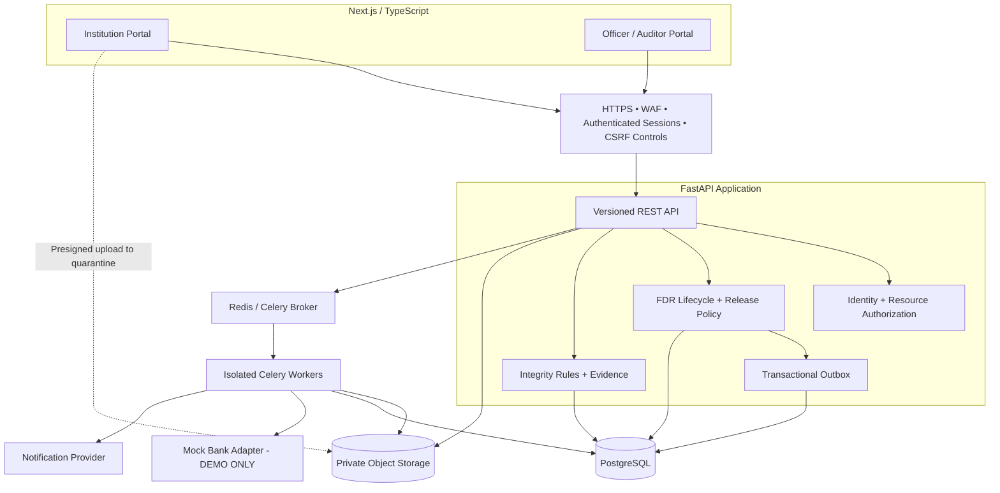

**Data integrity rule:** PostgreSQL is authoritative for instrument state, deadlines, approval history and notification records. Redis is used for queue transport and cache-like responsibilities—not as the sole store for maturity reminders or financial decisions.

### Technology stack

| Layer | Technologies | Responsibility |
| --- | --- | --- |
| Frontend | **Next.js App Router**, React, TypeScript, Tailwind CSS | Secure application shell and role-specific portals |
| UI | shadcn/ui, Radix primitives, TanStack Table / Query, Recharts | Accessible controls, registers, charts and fetching |
| Forms / documents | React Hook Form, Zod, PDF.js | Structured input, validation and evidence display |
| Backend | **FastAPI**, Pydantic 2 | Typed APIs and domain orchestration |
| Persistence | **PostgreSQL**, SQLAlchemy 2, Alembic | ACID transactions, constraints, versioning and migrations |
| Jobs | **Celery**, Redis | Scanning, extraction, reminders and outbox dispatch |
| Storage | Private S3-compatible object storage / MinIO locally | Quarantine, sanitized access and document versions |
| Extraction | PyMuPDF, Tesseract / OCR fallback, OpenCV where applicable | Evidence-aware PDF parsing |
| Verification | Replaceable `BankVerifier` interface + mock adapter | Synthetic response contract and failure simulation |
| QA / observability | pytest, Playwright, Ruff, structured logs, OpenTelemetry | Regression, security testing and operational diagnosis |

> [!NOTE]
> **As built in this repository.** The target stack above is the deployment shape. This build
> implements the frontend with **Vite + React + TypeScript + Tailwind** (same security model: an
> HttpOnly session cookie, CSRF on writes, no token in browser storage), persists through
> **SQLAlchemy 2 against SQLite by default** with PostgreSQL available via one environment
> variable, runs document scanning, extraction, the reminder scan and outbox dispatch **in-process**
> behind the same idempotency and dedupe keys a worker would use, stores objects in a **local
> private quarantine/clean namespace**, and extracts PDF fields with **pypdf**, escalating
> image-only pages to manual review instead of inventing a value.
> [`docs/ARCHITECTURE.md`](docs/ARCHITECTURE.md) lists every substitution and its rationale.

### Repository layout

```text
KoshSetu-SIH/
├── backend/                       # FastAPI modular monolith
│   ├── app/
│   │   ├── api/v1/routers/        # Thin typed route handlers
│   │   ├── api/deps.py            # Session, CSRF and scoping dependencies
│   │   ├── api/schemas.py         # Request / response contracts
│   │   ├── core/                  # Settings, security, authorization
│   │   ├── db/                    # Declarative models and session factory
│   │   ├── domains/
│   │   │   ├── fdr/               # Lifecycle, presentation, transitions
│   │   │   ├── documents/         # Scanner, extraction, sample generator
│   │   │   ├── bank/              # Provider port + mock adapter
│   │   │   ├── release/           # Checklist policy (policy.yaml)
│   │   │   ├── risk/              # Rule catalogue (rules.yaml) + engine
│   │   │   ├── notifications/     # Thresholds, dedupe, outbox dispatch
│   │   │   └── audit/             # Append-only, digest-chained events
│   │   ├── infrastructure/storage # Private object store adapter
│   │   └── seed.py                # Deterministic synthetic dataset
│   └── tests/                     # Unit, security-boundary and E2E scenarios
├── frontend/                      # Vite + React + TypeScript + Tailwind
│   └── src/
│       ├── components/            # App shell, evidence panel, PDF viewer,
│       │                          # clearance matrix, accessible primitives
│       ├── lib/                   # API client, DTOs, query hooks, session,
│       │                          # formatting and status vocabulary
│       └── pages/                 # Institution, official and admin workspaces
├── docs/
│   ├── ARCHITECTURE.md            # What is implemented, and where it stops
│   ├── DEMO_SCRIPT.md             # Seven-step walkthrough of the seeded data
│   ├── API.md                     # Route catalogue and error taxonomy
│   └── assets/                    # Brand and interface previews
└── README.md
```

---

## Getting started

> [!NOTE]
> This build runs as **two processes and no external services**: the API on `:8000` and the web app
> on `:5173`. SQLite and a local private object store stand in for PostgreSQL and S3 so the
> prototype starts anywhere; point `KOSHSETU_DATABASE_URL` at PostgreSQL for the deployment shape
> described above. [`docs/ARCHITECTURE.md`](docs/ARCHITECTURE.md) records each such substitution
> and why it is safe for a demonstration.

### Prerequisites

- Python 3.12+
- Node.js 20+ and npm
- Git

### Backend

```bash
cd backend
python3 -m venv .venv
./.venv/bin/pip install -r requirements.txt
cp .env.example .env                        # optional; defaults work locally
./.venv/bin/python -m app.seed --reset      # synthetic institutions, users and cases
./.venv/bin/uvicorn app.main:app --reload --port 8000
```

### Frontend

```bash
cd frontend
npm install
npm run dev
```

| Service | Development URL |
| --- | --- |
| Web portal | `http://localhost:5173` |
| API | `http://localhost:8000/api/v1` |
| OpenAPI UI (development only; hidden in production) | `http://localhost:8000/api/v1/docs` |

The dev server proxies `/api` to the API, so the session cookie stays first-party and no CORS
exception is needed.

### Demonstration accounts

Every account uses the password `Demo@12345` — local demonstration only, never reused elsewhere.

| Email | Role / Organization | Scope / Key Test Scenario |
| :--- | :--- | :--- |
| `submitter@coastal.demo` | Institution Submitter — Coastal Institute of Tech | Draft FDR, upload PDF receipt, attest & submit |
| `approver@coastal.demo` | Institution Approver — Coastal Institute of Tech | Institutional attestation and release signoff |
| `submitter@highland.demo` | Institution Submitter — Highland School of Mgmt | Discrepancy & clarification workflow |
| `submitter@sunrise.demo` | Institution Submitter — Sunrise College of Engg | Maturity alerts & successor instrument replacement |
| `submitter@riverine.demo` | Institution Submitter — Riverine Polytechnic | Scoped institution registry & activity history |
| `scrutiny@aicte.demo` | AICTE Scrutiny Officer (Southern & Western RO) | Side-by-side OCR review, field discrepancy flags |
| `scrutiny2@aicte.demo` | AICTE Scrutiny Officer (Northern & Central RO) | Multi-tenant regional FDR scrutiny queue |
| `supervisor@aicte.demo` | Competent Authority / Approver (Director Reg.) | Maker-checker dual-control release final approval |
| `finance@aicte.demo` | Finance Bureau Clearance Officer | Bureau prerequisite signoff (`CLEARANCE_FINANCE_BUREAU`) |
| `pgrc@aicte.demo` | Public Grievance / Legal Cell Officer | Litigation & encumbrance clearance (`CLEARANCE_LEGAL_CELL`) |
| `vigilance@aicte.demo` | Vigilance / Approval Bureau Officer | Institutional compliance signoff (`CLEARANCE_APPROVAL_BUREAU`) |
| `auditor@aicte.demo` | Oversight Auditor (Read-only) | Inspect append-only digest-chained audit trail |
| `admin@aicte.demo` | Security Administrator | System health, rule catalogue & integrity engine |

### Core environment configuration

`backend/.env.example` lists every supported setting:

```dotenv
KOSHSETU_ENVIRONMENT=local                      # local | demo | production
KOSHSETU_DATABASE_URL=sqlite:///./data/koshsetu.db
KOSHSETU_JWT_SECRET=<local-only-secret>
KOSHSETU_FDR_HMAC_KEY=<local-only-key>          # instrument lookup tokens and simulator signing
KOSHSETU_MOCK_BANK_ENABLED=true
KOSHSETU_STORAGE_ROOT=./data/objects
KOSHSETU_MAX_UPLOAD_BYTES=10485760
```

- The API **refuses to start** with `KOSHSETU_ENVIRONMENT=production` while the mock bank is
  enabled, or while a development secret is still in place.
- Secrets belong in the ignored `.env` or an approved secret manager, never in source control.
- A real bank adapter requires formal authorization, contracts, credentials and a separate security
  review. The port exists; the implementation deliberately raises `NotImplementedError`.

> [!WARNING]
> This setup is for **local demonstration**, not government production hosting. Do not expose it
> publicly, and do not import real institutional financial documents into it.

---

## Workflow: from submission to controlled release

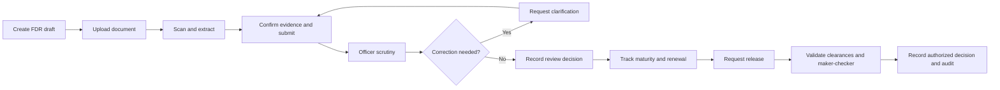

Important distinctions are enforced across 7 independent dimensions in data, API and UI:

| Independent dimension | Canonical states | Controlled by | Why it matters |
| :--- | :--- | :--- | :--- |
| **`submission_status`** | `DRAFT`, `UPLOADED`, `SUBMITTED`, `CORRECTION_REQUESTED`, `WITHDRAWN` | Institution + Scrutiny | Tracks document submission progress without altering legal instrument state |
| **`instrument_status`** | `REGISTERED`, `ACTIVE`, `SUPERSEDED`, `MATURED`, `RELEASE_RECORDED`, `ARCHIVED` | Domain Engine / Policy | Authoritative lifecycle of the underlying financial guarantee |
| **`document_processing_status`** | `QUARANTINED`, `CLEAN`, `EXTRACTING`, `READY`, `FAILED` | Security & Parser Workers | File scanning and OCR pipeline jobs are not administrative decisions |
| **`bank_verification_status`** | `NOT_REQUESTED`, `PENDING`, `MOCK_MATCH`, `MOCK_MISMATCH`, `MOCK_ERROR`, `AUTHENTICATED_EXTERNAL`, `EXTERNAL_UNAVAILABLE` | Bank Adapter Policy | Explicit provenance: simulations can never masquerade as bank authentication |
| **`review_status`** | `QUEUED`, `IN_REVIEW`, `CLARIFICATION_REQUIRED`, `ACCEPTED`, `REJECTED` | Scrutiny Officers | Administrative scrutiny judgment remains accountable and uncoupled from parsing |
| **`lien_status`** | `UNKNOWN`, `CLAIMED`, `CONFIRMED`, `DISPUTED`, `RELEASED` | Authorized Bank Record | Legal encumbrance status confirmed by issuing bank |
| **`release_status`** | `NOT_REQUESTED`, `REQUESTED`, `DOCUMENTS_PENDING`, `CLEARANCES_PENDING`, `ON_HOLD`, `READY_FOR_DECISION`, `APPROVED`, `REJECTED`, `CLOSED` | Clearance / Approver | Release approval is strictly administrative and distinct from fund movement |

A maturing FDR does not automatically become releasable. Policies determine prerequisites; each material transition is authorized, version-checked and audited.

---

## API overview

All domain endpoints live under **`/api/v1`**. JSON responses use a consistent `data` / `meta` envelope, and errors include a safe machine-readable code plus a correlation identifier. Sensitive writes support idempotency and optimistic concurrency controls.

| Area | Endpoint | Purpose |
| --- | --- | --- |
| Identity | `GET /api/v1/me` | Current identity, effective roles, scope and session constraints |
| Identity | `GET /api/v1/institutions/me` | Authenticated institution profile and accreditation metadata |
| Registry | `GET /api/v1/fdrs` | Authorized, paginated instrument register (scoped by role/region) |
| Registry | `GET /api/v1/fdrs/{id}` | Full FDR case detail, version history and permitted evidence summary |
| Draft | `POST /api/v1/fdrs/drafts` | Create institution-scoped FDR draft |
| Draft | `PATCH /api/v1/fdrs/{id}/draft` | Edit draft claims (disabled once submitted) |
| Upload | `POST /api/v1/upload-sessions` | Initiate restricted document transfer and obtain presigned POST policy |
| Upload | `POST /api/v1/upload-sessions/{id}/finalize` | Validate uploaded object existence, size/hash, and enqueue scanner |
| Jobs | `GET /api/v1/jobs/{id}` | Poll asynchronous extraction/scan job status (opaque IDs) |
| Documents | `GET /api/v1/fdrs/{id}/documents/{docId}/download` | Issue scoped, short-lived signed document download URL |
| Submit | `POST /api/v1/fdrs/{id}/submit` | Attest and submit FDR for regulatory scrutiny (idempotent) |
| Scrutiny | `POST /api/v1/fdrs/{id}/scrutiny` | Record authorized officer decision (`QUEUED`, `ACCEPTED`, `REJECTED`, etc.) |
| Simulation | `POST /api/v1/fdrs/{id}/mock-bank-check` | Run explicitly simulated bank scenario with strict `MOCK_BANK` provenance |
| Evidence | `GET /api/v1/fdrs/{id}/verification-checks` | Retrieve source-aware verification check history |
| Replacement | `POST /api/v1/fdrs/{id}/replacements` | Create and link successor FDR instrument (preserving predecessor lineage) |
| Maturity | `GET /api/v1/maturities` | Server-derived deadline windows (30/60/90 days) and open actions |
| Integrity | `GET /api/v1/exceptions` | Evidence-backed policy engine findings with rule IDs |
| Release | `POST /api/v1/release-requests` | Initiate administrative release request for an eligible instrument |
| Release | `GET /api/v1/release-requests/{id}` | Checklist, current version, recorded clearances and signoffs |
| Clearance | `POST /api/v1/release-requests/{id}/clearances/{code}/decide` | Record bureau-specific clearance decision with evidence |
| Approval | `POST /api/v1/release-requests/{id}/approve` | Dual-control maker-checker final approval (atomic transaction) |
| Audit | `GET /api/v1/audit-events` | Scoped, append-only chronological audit trail with correlation IDs |
| Reports | `POST /api/v1/reports/exports` | Schedule authorized, audited report export with cryptographic receipt |
| Notices | `GET /api/v1/notifications` | Paginated in-app notices and deadline alerts |
| Notices | `POST /api/v1/notifications/{id}/ack` | Idempotent notification acknowledgement |

<details>
<summary><strong>Example — structured FDR response</strong></summary>

```json
{
  "data": {
    "fdr_id": "0c7e67ea-290d-4534-a1b1-9257007db86f",
    "instrument_status": "ACTIVE",
    "review_status": "ACCEPTED",
    "bank_verification": {
      "status": "MOCK_MATCH",
      "source_kind": "MOCK_BANK",
      "is_simulated": true,
      "scenario_id": "MATCH_AND_LIEN_CONFIRMED",
      "verified_at": "2026-10-26T10:00:00Z"
    },
    "document_extraction": {
      "status": "READY",
      "principal_amount": "2500000.00",
      "source_page": 1,
      "confidence": 0.94
    },
    "version": 7
  },
  "meta": {
    "request_id": "req-demo-1042",
    "as_of": "2026-10-26T10:01:00Z"
  }
}
```

This response represents a **synthetic demo case**, not a real authenticated financial instrument. `MOCK_MATCH` and `ACCEPTED` record independent simulation and officer-workflow outcomes.

</details>

<details>
<summary><strong>Example — concurrency-safe error response</strong></summary>

```json
{
  "error": {
    "code": "STATE_CONFLICT",
    "message": "This record has changed. Review the latest version before retrying.",
    "field_errors": {},
    "request_id": "req-demo-1043"
  }
}
```

Sensitive commands require `Idempotency-Key` and/or record-version validation (such as `If-Match`) according to the endpoint contract. Every request is reauthorized on the server, including downloads and exports.

</details>

---

## Security by design

The design prioritizes **confidentiality, integrity, access control, reliable recovery and traceability before speed**. Frontend visibility rules are not treated as security boundaries.

| Area | Controls |
| --- | --- |
| **Authentication** | OIDC-compatible identity design, secure cookie-backed sessions, official-user MFA and session expiration |
| **Authorization** | Role + resource/assignment checks for institution, region, bureau, record and action; server-side enforcement |
| **Sensitive operations** | Maker–checker separation, mandatory reasons, policy prerequisites, record-version checks and idempotency |
| **Document intake** | Limited upload permissions, format/size checks, malware scanning, quarantine, private storage and expiring download authorization |
| **Financial data** | Exact decimal amounts, database constraints, restricted exports, controlled retention and encrypted storage |
| **Browser security** | CSRF defense for cookie-authenticated writes, restrictive CSP, no persistent browser token storage and no sensitive caching |
| **Background jobs** | PostgreSQL-backed job/outbox state, dedupe keys, bounded retries and replay-safe handling |
| **Auditability** | Append-only application events, actor attribution, before/after states, evidence version and correlation ID |
| **Observability** | Redacted structured logs and traces; no credentials, raw FDR identifiers, bank payloads or document contents in telemetry |
| **Operations** | Isolated environments, private services, secret management, backup/restore procedures and incident runbooks |

### Threats we explicitly test

Broken object-level authorization (BOLA/IDOR), cross-institution access, CSRF, repeated approval requests, stale-record modifications, malicious PDF uploads, unsafe file retrieval, notification retries, privilege escalation, forged client-side roles and tampering with audit evidence.

### AICTE Administrative Hierarchy & Bureau Clearances

To ensure alignment with actual regulatory operations, KoshSetu maps its multi-tenant authorization to AICTE's organizational structure:
- **Regional Jurisdictions:** Scrutiny officers operate under scoped regional jurisdiction filters:
  - Northern Regional Office (NRO, Kanpur)
  - Western Regional Office (WRO, Mumbai)
  - Southern Regional Office (SRO, Chennai)
  - South-Western Regional Office (SWRO, Bangalore)
  - Central Regional Office (CRO, Bhopal)
  - Eastern Regional Office (ERO, Kolkata)
  - North-Western Regional Office (NWRO, Chandigarh)
- **Functional Bureau Roles:**
  - **Regulation Bureau (Problem Sponsor):** Manages policy configurations, deposit mandates, and regulatory compliance.
  - **Approval Bureau:** Validates institutional eligibility, intake quotas, and program approvals.
  - **Finance & Accounts Bureau:** Verifies refund eligibility, statutory dues, and penalty clearance.
  - **Legal Cell:** Verifies absence of court attachments or judicial holds on pledged deposits.
- **Enforceable Release Clearances (`clearance_code`):**
  A release request cannot transition to `READY_FOR_DECISION` until the following preconditions are affirmatively resolved by authorized bureau representatives:
  1. `CLEARANCE_APPROVAL_BUREAU`: Institution program status verified.
  2. `CLEARANCE_FINANCE_BUREAU`: No outstanding financial encumbrances.
  3. `CLEARANCE_LEGAL_CELL`: No active litigation or regulatory freeze.
  4. `MAKER_CHECKER_SEPARATION`: Final approver (`OFFICIAL_APPROVER`) must strictly differ from the clearance preparer (`checker_id != prepared_by`).

### Government and production boundary

KoshSetu uses **[GIGW 3.0](https://guidelines.india.gov.in/)**, **[OWASP ASVS](https://asvs.owasp.org/)** and accessibility standards as engineering references. These are **targets and design inputs, not certifications**. A real government deployment requires its owner to approve policy rules, hosting/data-residency obligations, identity integration, retention, security assessment, accessibility conformance and any bank API contracts.

---

## Testing and quality gates

```bash
# Backend: domain invariants, the P0 security matrix and end-to-end scenarios
cd backend && ./.venv/bin/python -m pytest        # 47 tests

# Frontend: strict type check and production build
cd frontend && npx tsc -b && npm run build
```

Critical regression coverage includes:

- Institution A cannot read or mutate Institution B's FDRs, documents or exports.
- A scanned document with mismatched principal requires review rather than automatic authenticity claims.
- A mock bank result always retains its simulated source and cannot be promoted to authorized bank evidence.
- An officer cannot approve their own restricted release action.
- Missing or negative clearance blocks release approval.
- Double submission and worker retries do not duplicate financial transitions or reminders.
- Concurrent reviewers receive a conflict instead of silently overwriting one another.
- Historical FDR evidence survives renewal/replacement.
- Unauthorized PDF links, expired sessions and malicious documents are rejected safely.

**Performance instrumentation:** API latency distributions, document-processing duration, queue age, notification delay and error rates. Publish measured benchmark results only with their dataset, environment and test method; no unsupported performance claims are included here.

---

## SIH demonstration flow

A single walkthrough shows the platform's value without hiding negative cases:

1. **Dashboard:** inspect active deposits, near-term maturities and outstanding review work.
2. **Submission:** an institution uploads a synthetic FDR; scanning and field extraction complete.
3. **Discrepancy:** deliberately submit an amount that differs from the PDF; show exact evidence and review action.
4. **Bank simulation:** run `MATCH_AND_LIEN_CONFIRMED`; inspect explicit `MOCK_BANK` provenance rather than claiming real verification.
5. **Officer scrutiny:** request clarification or record the appropriate authorized case decision.
6. **Maturity:** open an FDR nearing its due date and see its assigned reminder and next action.
7. **Renewal/replacement:** link the successor instrument while preserving its predecessor and attachments.
8. **Release:** attempt approval with a missing clearance (blocked), complete prerequisites, then approve using a separate authorized checker.
9. **Audit:** reconstruct the case from its document versions, decisions, timestamps and event correlation IDs.

All names, instruments, banks, documents and clearances in this walkthrough are **synthetic**.

---

## Design principles

KoshSetu intentionally uses a modern interface **without compromising clarity in financial workflows**:

- Deep navy navigation, light content canvas and predominantly solid, high-contrast data surfaces.
- Limited glass effects for noncritical summary surfaces—not over evidence or financial tables.
- Unambiguous badges for `Submitted`, `OCR extracted`, `Mock bank check`, `Officer accepted`, `Release approved` and other independent events.
- Keyboard-operable document review and forms, semantic markup, visible focus and alternatives to charts.
- Small, purposeful transitions; no animation that obscures an approval outcome.

The brand mark represents a protected document and a circular, accountable workflow. It is intentionally distinct from official government seals and national emblems.

---

## Documentation and specifications

| Resource | Path / Link | Scope |
| --- | --- | --- |
| **Backend Specification** | [`docs/backend-specification.md`](docs/backend-specification.md) | Architecture, security, state machines, API contracts & implementation patterns |
| **Frontend Specification** | [`docs/frontend-specification.md`](docs/frontend-specification.md) | UI/UX design system, screen catalog, interaction flows & brand identity |
| Architecture Notes | [`docs/ARCHITECTURE.md`](docs/ARCHITECTURE.md) | Implemented architecture, domain models and runtime details |
| Demonstration Script | [`docs/DEMO_SCRIPT.md`](docs/DEMO_SCRIPT.md) | 9-step evaluator walkthrough across synthetic test institutions |
| API Route Catalogue | [`docs/API.md`](docs/API.md) | Complete endpoints, error taxonomy and concurrency contracts |
| SIH 2026 Problem Statements | [sih.gov.in/sih2026PS](https://www.sih.gov.in/sih2026PS) | Problem Statement SIH26265 issued by AICTE Regulation Bureau |
| FastAPI | [fastapi.tiangolo.com](https://fastapi.tiangolo.com/) | Typed Python REST API framework |
| Vite / React | [vitejs.dev](https://vitejs.dev/) | Client build system with TypeScript and Tailwind CSS |
| SQLAlchemy 2 | [docs.sqlalchemy.org/en/20](https://docs.sqlalchemy.org/en/20/) | Typed Python ORM with SQLite and async PostgreSQL support |
| Alembic | [alembic.sqlalchemy.org](https://alembic.sqlalchemy.org/en/latest/) | Transactional database schema migrations |
| PostgreSQL | [postgresql.org/docs/current](https://www.postgresql.org/docs/current/) | Relational database engine (production source of truth) |
| OWASP ASVS 5.0 | [asvs.owasp.org](https://asvs.owasp.org/) | Application Security Verification Standard |
| OWASP API Security | [owasp.org/API-Security](https://owasp.org/API-Security/) | Top 10 API Security Risks mitigation baseline |
| Government of India GIGW 3.0 | [guidelines.india.gov.in](https://guidelines.india.gov.in/) | Guidelines for Indian Government Websites and Apps |
| WCAG 2.2 | [w3.org/TR/WCAG22](https://www.w3.org/TR/WCAG22/) | Web Content Accessibility Guidelines (Target: AA) |

### Contributing

Changes to state transitions, permissions, audit fields, bank provenance, release clearances or API response contracts require corresponding tests and design review. Never include real FDRs, credentials, bank account details or privileged government documents in issues, pull requests or demo fixtures.

### Acknowledgment

Built for **Smart India Hackathon 2026**, addressing **AICTE Regulation Bureau problem statement SIH26265**. The name, design and software are an independent student project; references to AICTE identify the problem sponsor, not an endorsement or official deployment.

---

<div align="center">
  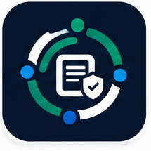

  <strong>KoshSetu</strong><br />
  <sub>Every instrument accounted for. Every decision traceable.</sub>
</div>
