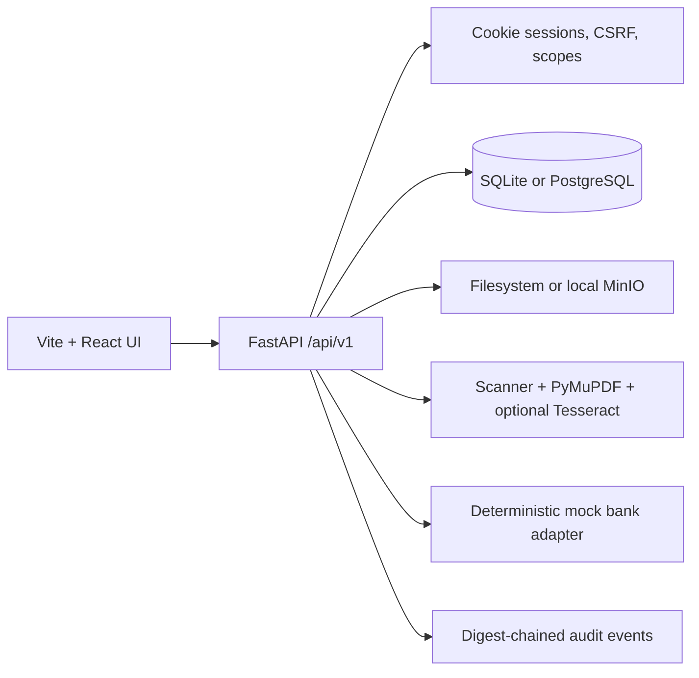

# Implemented architecture

This document describes the code that exists today. The repository is a
modular monolith: one FastAPI process owns the transactional workflow, with
the React client talking to versioned REST routes through the Vite proxy.

## Backend boundaries

The routers in `backend/app/api/v1/routers` expose authentication, FDR
records, uploads, verification, releases, notifications, analytics, imports,
audit export and local operational routes. SQLAlchemy models hold the
authoritative state. Alembic migrations create the legacy schema and the
security tables.

Document intake first quarantines and scans a PDF. Extraction uses PyMuPDF
text spans and records page coordinates, source text, method and an
uncalibrated confidence signal. If OCR is enabled, Tesseract is invoked with
the configured language set (default `eng+hin`) and the result remains a human
review candidate. Missing fields, conflicts, claim mismatches, maturity
inconsistencies and OCR-derived values cannot silently become accepted facts.

The mock bank adapter produces deterministic fixtures such as amount mismatch,
missing lien, timeout, maturity mismatch and replayed response. Its output is
stored as simulated evidence and never represents a real bank confirmation.

Release decisions use version checks, required evidence, clearance records,
maker-checker separation and database locks. Audit events include a canonical
digest and previous-digest pointer. Exports verify the chain before returning
scoped records.

## Frontend boundaries

The Vite client has institution, official, auditor and administrator routes.
The app shell uses an HttpOnly session cookie, CSRF headers for writes, route
code splitting, dense expandable tables, a dark independently scrollable
sidebar, PDF evidence navigation, import preview and analytics screens.

## Explicit limits

Government SSO/MFA, real bank connectivity, external notification delivery,
managed cloud object storage, and human confidence calibration are not
implemented. Firebase is documented as a future adapter in
`docs/FIREBASE_ARCHITECTURE.md`; no credential or outbound delivery is enabled.
These limits are enforced in settings and reflected in the UI rather than
being implied by a mock result.
